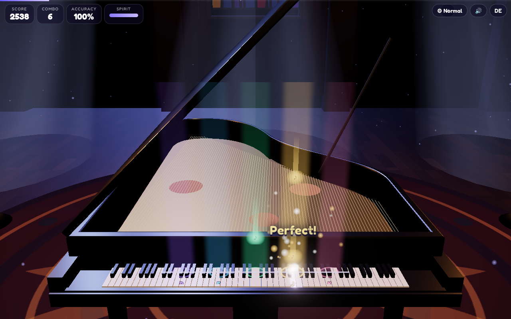
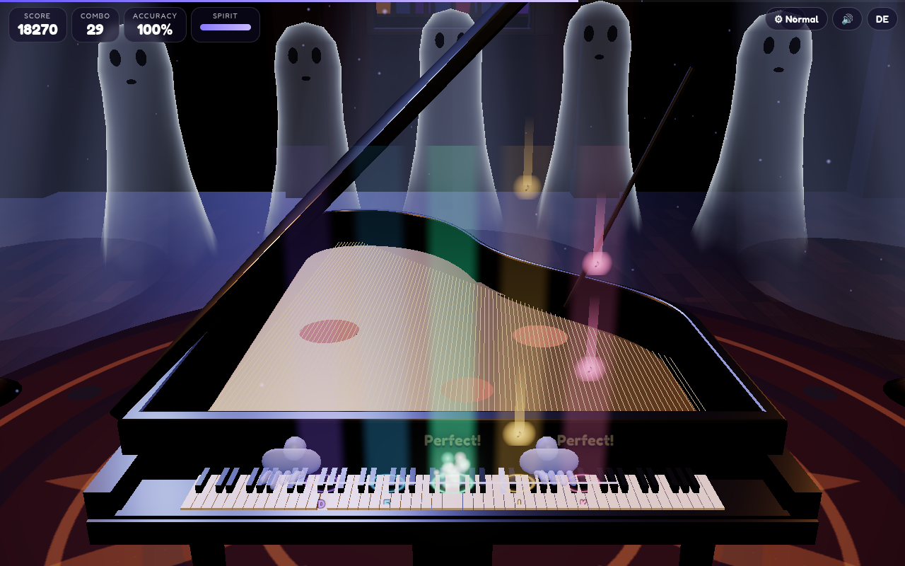

# 🎹 Haunted Piano

A gothic 3D Halloween rhythm game. A ghost sits at a concert grand in a candle-lit music room – moonlight through stained glass, floating sheet music, portraits whose eyes follow every note. Play along with Bach, Grieg, Chopin and the Dies Irae: hit the falling notes right on the glowing line, or repeat the ghost's phrases from memory. Big combos wake the room: the chandelier swings, a ghost choir rises and sings with you, lightning strikes.

**Play:** [online version (GitHub Pages)](https://frank-otto.github.io/haunted-piano/)

## How to play
- **Song mode:** notes fall in coloured lanes onto the keys. Press **D F Space J K** (Easy D F J K, Hard S D F J K L, also 1–6) or tap the lanes. Perfect / Great / Good / Miss, combo multiplier, accuracy and a grade from S to D. Missed notes drain the spirit bar – at zero the ghost takes over.
- The ghost's left hand plays the accompaniment, its right hand fills in the fast notes, so every song sounds whole.
- **Ghost Echo:** the ghost plays a phrase – play it back. Phrases grow longer, 8 rounds, 3 candles.
- **Free play:** the whole 88-key grand: computer keyboard (A–K row, W E T Y U for black keys, Shift = octave up) or click/tap the keys. Play 24 notes and the choir joins in.

Songs: Toccata in D minor (J. S. Bach), In the Hall of the Mountain King (E. Grieg, speeds up!), Funeral March (F. Chopin), Dies Irae (Gregorian chant) – all public domain.

Difficulty **Easy / Medium / Hard** (lanes, fall speed, timing windows, ×1–1.5 points), remembered with a highscore per song and difficulty. **Kids mode:** 3 big lanes, slower, generous timing, missed notes are played by the ghost – never fails.

Extras: the language follows your phone or browser (German devices get German, everything else English), with a small **DE/EN** toggle (remembered), shareable **score card** (PNG, 1080×1350), **quality levels** (Low / Normal / High / Ultra, auto step-down), mobile layout with a lowered lid, a ghost playing in the menu.

## Tech
Three.js (WebGL): a modelled grand (bentside rim, gold plate, strings, 88 pivoting keys, hammers, lid on its prop stick), translucent fresnel ghost hands and choir, stained-glass windows with volumetric moon shafts, candelabras with flickering point lights, a swinging crystal chandelier, ACES tone mapping and a restrained bloom (no glare). Real recorded piano samples with a convolution reverb. Bundled with esbuild into one classic script, so it runs straight from `file://`.

## Run locally
Open `index.html` (on a Mac you can also double-click `start.command`). Rebuild after editing `src/`: `npm install && npm run build`.

## Tests
`python3 test/test_game.py` (Playwright + Chrome, headless WebGL, served over a local web server): keyboard and touch hits, judgements, misses and failing, combo events (chandelier, choir), song end and grades, highscores, PNG card, EN/DE memory, difficulties, kids, echo and free mode, mobile layout, glare and camera checks, no console errors, no synth sounds.
`python3 test/test_mobile.py`: 8 phone configurations (iPhone 13 / 8 / SE in WebKit, Pixel 7 in Chromium, portrait and landscape). It checks that every button is tappable and at least 44 px, that nothing is cut off or scrolls, the auto language, one tap to play with sound, touch control and flat memory.

## Credits
All sounds are recorded CC0 samples – piano from FreePats "Upright Piano KW" (see `LICENSES/SOUNDS.md`). Three.js (MIT). Font: Fredoka (SIL Open Font License 1.1).

